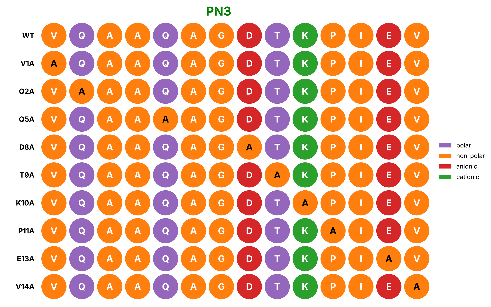

# Ala_scan

A Jupyter notebook that draws an alanine-scan figure for a short peptide.

It takes one peptide sequence, swaps each residue for alanine one position at a time, and plots every variant as a row of coloured circles. Each circle is coloured by amino acid class (polar, non-polar, anionic, cationic), and the alanine substitutions are marked so you can see where each one sits.



[](https://colab.research.google.com/github/VismayaShhree/Ala_scan/blob/main/Alanin_sca.ipynb)
[](https://doi.org/10.5281/zenodo.23483270)

## Run it in your browser

Click the **Open in Colab** badge above. You need a Google account, nothing else. Then choose **Runtime → Run all**.

## Run it on your computer

You need Python 3.10 or newer.

```bash
git clone https://github.com/VismayaShhree/Ala_scan.git
cd Ala_scan
pip install -r requirements.txt
jupyter notebook Alanin_sca.ipynb
```

## Use your own peptide

In the second cell, change this line to your sequence (one-letter codes, capital letters):

```python
original_sequence = "PDEAK"
```

Run all cells again. The figure updates to your sequence.

Residues that are already alanine are skipped. The figure is also saved as `ala_scan.png` (300 dpi), ready for a paper or slide.

## Citation

If you use this notebook, please cite:

> If you use this notebook, please cite the archived code:

and the archived code:

> Lokesh Dhanashree (2026). Ala_scan: alanine-scan visualisation notebook. (v1.0.0). Zenodo. https://doi.org/10.5281/zenodo.23483270

The associated article is in preparation:

> Lokesh, Dhanashree., et al. PAPER TITLE. In preparation.

## License

MIT. See [LICENSE](LICENSE).
